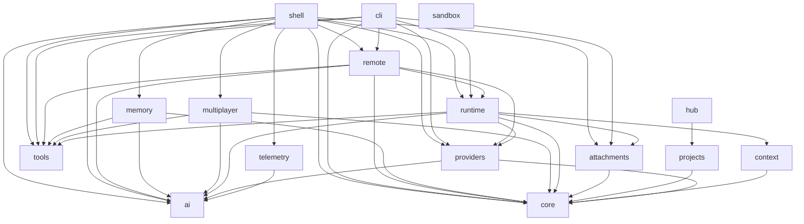

# Vivianne architecture

## Crates

| Crate | Role |
|---|---|
| `core` | Domain types: threads, messages, plans, memory, attachment references. No I/O. |
| `context` | What is added to a conversation beside the person's words: workspace instruction files, the clock, the tmux pane, mentioned sessions, `@file` completion. |
| `attachments` | Durable images and files attached to messages: content-addressed store, image normalization, request-sized versions. |
| `plugins` | Context, typed services and events, reversible registrations. |
| `providers` | One trait, adapters for OpenAI-compatible, Anthropic, Google, local. |
| `tools` | Shell, browser, desktop control, and the working directory the file and shell tools start from (`workdir`). |
| `runtime` | The single agent loop for chats and 24/7 agents, saved threads (an append-only log per thread), checkpoints, and the views folded from a thread's history. |
| `projects` | Shared projects: roles and the one permission check, membership and join-request rules, agent-run permissions, audit events. Pure, with storage behind a trait (`docs/plans/projects.md`). |
| `hub` | `viv-hub`, the hosted service for shared projects: `projects` over SQLite, bearer sessions and an HTTP API. Nothing else depends on it. |
| `sandbox` | Starting, owning and confining other programs. The only crate besides the shell's window glue that uses `unsafe`. |
| `app-api` | Local versioned API for micro-app processes. |
| `shell` | GPUI app: window, panels, theme. The only crate that touches GPUI. |

Dependency direction: `shell` -> `runtime` -> `providers`, `tools`, `plugins` -> `core`.

## Conversation storage and views

A thread is `~/.viv/agent/threads/<id>.jsonl` (see `crates/runtime/src/log.rs`): a header line, then one line per message and per settings change. A save that only adds messages appends; one that shortened the history first keeps the old file as `<id>.g<N>.jsonl.gz`. The format is a chain of versions (`formats.rs`): an older file is carried forward (its source kept as `<id>.v<N>.bak`), a newer one is refused and never written over. One writer per thread holds an OS lock on `<id>.lock` (`lease.rs`).

The agent loop saves before every model request and before a step's tools run, and stops with an error if the save fails (`Agent::set_checkpoint`, fail-closed). Each assistant message carries the time it was added and how long its reply took (`Message::at`, `Message::timing`).

Views are folds over the history, run by a registry and cached beside the thread in `<id>.proj.json` with a digest of the messages they cover (`projection.rs`, `session_stats.rs`). A session log can be exported with secrets removed (`export.rs`, `viv thread export`); quoting a message is plain Markdown (`quotes.rs`). The `working_directory` tool moves where relative paths start, inside the project only, and a resumed run replays the moves from the saved calls. What the original `session` package group has that Vivianne does not is in `session-package-gaps.md`.

## Phases

0. Crate split and event bus; Tauri events/commands become plain calls; new provider adapters; agent merge. Old app still runs on the same backend.
1. GPUI shell: window, title bar, thread tabs, theme. Spike: (a) streaming markdown transcript at 60fps with code, diff, selection; (b) transparent always-on-top click-through overlays on Windows; (c) terminal via `alacritty_terminal`.
2. Chat transcript and composer. **Go/no-go gate.** If chat feels bad in GPUI, stop.
3. Rail: files, preview, terminal, plan view.
4. Home and Settings.
5. 24/7 agents and debugger.
6. Micro-apps: app API, panels schema, permission UI, mermaid and formulas.
7. Cutover: delete Tauri and the web frontend, MSI, updater.

Each phase is gated by `cargo fmt --check`, `cargo clippy -D warnings`, `cargo test --workspace`.

## The crate graph (R8.1)

This is the graph `scripts/check-boundaries.sh` enforces. An arrow means "may depend on".

Known gaps between this graph and the documented layering above: `ai` is the real foundation of eight crates though it is not in the original table; `runtime` reads `ai` directly (paths, settings, failure kinds); `core` holds the tool-name lists that decide approvals although `tools` does not depend on `core`; `plugins`, `app-api` and `hub` have no dependents yet; only `hub` depends on `projects`.
